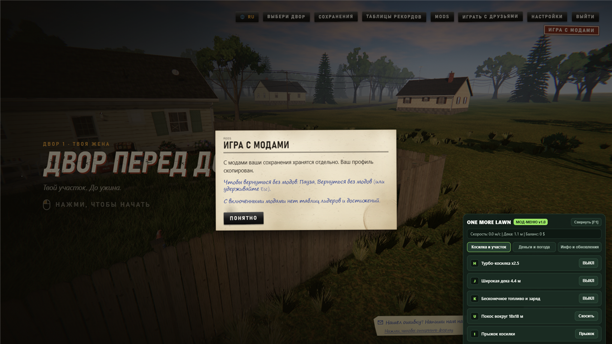
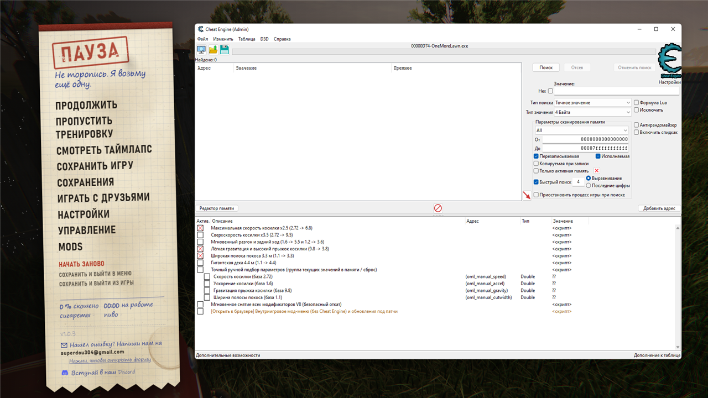

# One More Lawn - Мод-меню и таблица .CT

Скорость косилки `x2.5`, широкая дека `4.4 м`, бесконечное топливо, покос участка `18x18 м`, деньги и смена погоды + таблица `.CT` (`v1.0`, версия `1.0.3`, Windows и Steam Deck).

## Скачать
- **[Страница игры и все архивы на Boosty](https://boosty.to/cd_tixo/posts/67ce4af5-4975-4f8e-9f0c-e64ab7899433)**
- **[Архивы на GitHub Releases](https://github.com/neoru-droid/one-more-lawn-mod-ru/releases/tag/v1.0.0)** · [Как установить](#установка)
- **Новые релизы и заказ своей игры на [Boosty](https://boosty.to/cd_tixo):** подписка `120 ₽/мес` на все релизы или разовый пост `150 ₽`, своя игра в очередь - `350 ₽`, разбор вне очереди - `750 ₽`.
- **Обновления и новые релизы в Telegram:** [@neoru_droid](https://t.me/neoru_droid)

## Установка
1. **Windows:** распакуйте архив и запустите `OneMoreLawn-Trainer-Setup.exe` -> **«Установить мод-меню»** (ставит `neoru.trainer-ru.omlmod` в `%APPDATA%\One More Lawn\mods\`).
2. **Steam Deck / Linux (Proton):** распакуйте архив и выполните `sh install-steamdeck.sh --install`.
3. **Вручную:** скопируйте `neoru.trainer-ru.omlmod` в папку модов или перетащите в раздел **Mods**.
4. В главном меню откройте **Mods**, включите **One More Lawn - Mod Menu RU**, выберите участок и нажмите **«С модами»**. В игре `F1` открывает окно, `Tab` меняет вкладку, мышкой кликается через паузу (`Esc`).

## Функции мод-меню

- **Косилка и участок:** `H` турбо-косилка `x2.5`, `J` широкая дека `4.4 м`, `K` бесконечное топливо и заряд, `U` покос `18x18 м` вокруг игрока, `I` прыжок косилки.
- **Деньги и погода:** `O` / `3` `+1 000 $` и `+10 000 $`, `4..7` День / Закат / Ночь / Шторм, `8` / `9` сброс косилки и всех настроек.

## Таблица Cheat Engine (`OneMoreLawn-CheatTable-RU-v1.0.zip`)

8 пунктов в `OneMoreLawn_RU_v1.0.CT`: скорость `x2.5 / x3.5`, разгон и задний ход, лёгкая гравитация (`9.8 -> 3.8`), ширина покоса `3.3 / 4.4 м` и сброс параметров при снятии галочки.

Нашли баг после патча - пишите в [Issues](https://github.com/neoru-droid/one-more-lawn-mod-ru/issues).

[Сайт каталога](https://neoru-droid.github.io/) · [Каталог на Boosty](https://boosty.to/cd_tixo/posts/2a55d7e9-0f53-4d93-9f66-280981158dec) · [Telegram](https://t.me/neoru_droid) · [GitHub](https://github.com/neoru-droid) · [MIT](LICENSE) · Автор: `neoru-droid`
